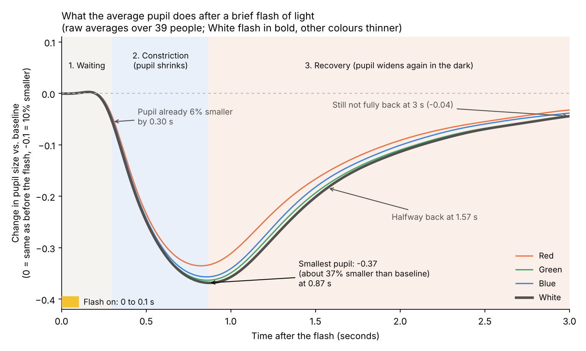
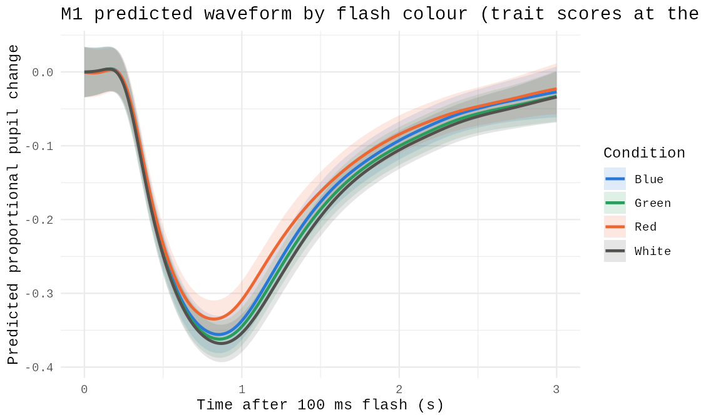

# Recreating analyses from a published pupil study: sensory traits and the pupil's response to light

A learning project. I took a 2026 paper on how the pupil reacts to a flash of light, downloaded the authors' public data, and recreated parts of the analysis to see which published numbers I could recover and where I could not.

**This is not a new finding, and it is not a replication.** The data and most of the modelling code are the authors' (see [NOTICE.md](NOTICE.md)). Terms in *italics* are explained in [docs/glossary.md](docs/glossary.md).

## What kind of check this is

| | What it means | Done here? |
|---|---|---|
| **Re-running the authors' code** on their data | Can the published numbers be regenerated from the shared files? | Yes, for model M1 only |
| **Recreating from the paper's description** | Write my own code from the methods text and compare with the published numbers | Yes, for inclusion, reliability and the average waveforms |
| **Replication** | Collect new data and see whether the finding holds | No |

Matching the published numbers shows that they can be recovered. It does not show that the study's conclusions are right, and one mismatch I could not explain (below) is not evidence of an error either.



## The study in one minute

When light enters the eye, the pupil automatically narrows and then slowly widens again. This is the *pupillary light reflex*. The paper asks whether it differs between people who describe themselves differently on a sensory-processing questionnaire (for example, people who say they are easily overwhelmed by sensations, or who actively avoid them).

- **People:** 39 young adults (44 were recorded; 5 had too few good trials).
- **Stimulus:** a 100 millisecond flash of white, red, green or blue light that fills the screen, followed by darkness. Each colour was shown 10 times.
- **Measurement:** pupil size, 500 times per second, for the 3 seconds after each flash.
- **Questionnaires:** the Adolescent/Adult Sensory Profile and scales for autism traits, ADHD symptoms, depression and anxiety.
- **Reported result:** the *average* pupil size did not differ with the sensory traits. The *shape* of the response over time did, most clearly for "Sensation Avoiding". The authors say the data cannot pin that difference to any particular moment.

## How to read the figure above

The figure shows what the average pupil does after a flash, using raw averages over the 39 people. (The paper's own Figure 1 has no labels on the curves, only a legend and caption, so the annotations here are mine.)

- **Vertical axis:** change in pupil size compared with just before the flash. Zero means no change. Minus 0.1 means 10% smaller. Lower on the chart means a smaller pupil.
- **Horizontal axis:** seconds after the flash starts. The flash itself lasts only the first 0.1 seconds, shown by the yellow bar.
- **Each line:** the average for one flash colour. The bold grey line is the white flash.

The line goes through three stages:

1. **Waiting (0 to about 0.3 s).** The pupil barely changes at first: there is a short delay between light reaching the eye and the pupil reacting. By 0.3 seconds it is only about 6% smaller. A tiny wobble just before the drop is visible in the average; I have not tried to interpret it.
2. **Constriction (about 0.3 to 0.87 s).** The pupil shrinks quickly. For the white flash it reaches its smallest size at about 0.87 seconds, around 37% smaller than before the flash.
3. **Recovery (after 0.87 s).** In the dark, the pupil slowly widens again. It is about halfway back at 1.6 seconds and still slightly smaller than baseline (about 4%) at 3 seconds.

**The colours.** Red gives the smallest constriction (lowest point -0.335) and white the largest (-0.368). Green and blue sit in between. These flashes were not matched for brightness or for how strongly they stimulate the eye's light-sensitive cells, so the differences should not be read as pure colour effects. The authors say the same in the paper.

| Flash | Brightness (cd/m²) | Melanopic stimulation (DER) |
|---|---|---|
| White | 228 | 0.94 |
| Green | 152 | 0.69 |
| Red | 59 | 0.01 |
| Blue | 17 | 6.33 |

(From the authors' `stimulus_metrics_condition_mean_sd.csv`. Melanopic DER measures how strongly a light stimulates one type of light-sensitive cell, melanopsin.)

### The model's version of the same picture

The authors' Figure 1 does not show raw averages. It shows what their statistical model predicts for an average person. When I re-ran the model (below), I got this:



It has the same timing, depth and colour order as the raw averages and, by eye, as the paper's Figure 1. The shaded bands are 95% confidence bands. They are wide at the very start even though every trial is set to zero there. My reading is that the model's prediction carries the uncertainty of its overall intercept (about 0.012 in the model summary), which is the same for all four colours and so makes the bands overlap. I have not tested that explanation. The title in this image is cut off at the right edge; the script now uses a shorter title.

## What I reproduced

| Check | Paper | My result | Match |
|---|---|---|---|
| People in the file / included | 44 / 39 | 44 / 39, same 5 excluded | Yes |
| Reliability of the average pupil response | 0.89 | 0.87 to 0.98, depending on how trials are split; 0.89 for random splits | Within range |
| Average waveform by colour | Fig. 1 (model predictions) | Raw averages and model predictions agree by eye with Fig. 1 | Yes (by eye) |
| Colour effects in model M1 | Red 0.0221, Green 0.0050, Blue 0.0117 | Identical to the reported precision | Yes |
| Trait effects on *average* pupil size | LowTh p = 0.437, Active p = 0.670 | p = 0.437, p = 0.671 | Yes |
| Trait-by-time *shape* terms, LowTh | F = 17.39 (edf 196.6), p < 0.001 | F = 22.0 (edf 163.2), p < 0.001 | Significant in both; numbers differ |
| Trait-by-time *shape* terms, Active | F = 32.41 (edf 181.7), p < 0.001 | F = 39.9 (edf 153.8), p < 0.001 | Significant in both; numbers differ |

The full model summary from my run is in [results/r/m1_summary_from_colab_run.txt](results/r/m1_summary_from_colab_run.txt).

## What did not match, or was unclear

- **The size of the shape effects.** Both are significant as published, but my F values are higher and my effective degrees of freedom are lower. I used the same model specification and the same mgcv version (1.9-4) as the paper reports. I do not know why the numbers differ and have not tried to find out.
- **Who counts as "included".** Using the authors' rejection flag gives 39 people. Counting only trials that actually contain data gives 38, because participant 12 has six White trials marked as kept but only three with data. The paper's 39 follows the flag.
- **Reliability depends on a choice the paper does not spell out.** The paper says it split trials into odd and even. I tried five readings; they give corrected reliabilities from 0.87 to 0.98 (table in [results/python/split_half_reliability.csv](results/python/split_half_reliability.csv)). I did not choose the one that lands on 0.89. Note that this reliability measures how consistently *people differ* from each other; it does not show that the waveform *shape* is reliable.

## What I did not do

- **Models M2, M3 and the four quadrant models**, and the paper's Figures 2 to 4 with their simultaneous confidence bands. The paper reports that those bands include zero across the whole 3 seconds, so no specific time window shows a reliable difference. The "Sensation Avoiding is strongest" statement comes from the quadrant models, which I did not run.
- **The raw signal processing.** The public file is already cleaned, averaged over both eyes and reduced to 100 readings per second, so the blink handling and filtering described in the paper cannot be repeated.
- **Any new analysis.**

## What the model is asking, in plain words

The statistical model (a *GAMM*) fits one flexible curve to the average response, lets each flash colour bend it differently, and lets every person have their own baseline and their own curve shape. It then adds two terms that ask: does a person's trait score change the *shape* of the curve? That is the "trait by time" term. A separate term asks whether the trait changes the *average* size. The paper's answer is no for the average and yes for the shape. A correction for neighbouring time points being nearly identical (*AR(1)*) keeps the confidence statements honest.

## Run it yourself

1. Get the data (see [data/README.md](data/README.md)) and put `dataset_gamm_long_3s.csv` in `data/`.
2. Python checks, from the repository root:
   ```
   pip install -r requirements.txt
   python python/reproduce_checks.py data/dataset_gamm_long_3s.csv
   python python/annotate_waveform.py
   ```
   These write tables and figures to `results/python/` and `figures/`. They take a few seconds.
3. Model M1 in R (slow; use the R runtime in Colab if you do not have R):
   ```
   Rscript r/run_m1.R
   ```
   An earlier version of this script ran to completion in Colab. The commented version in this repository has not been re-run.

## Repository layout

```
README.md                      this file
NOTICE.md                      credits and licence notes for the authors' code and data
requirements.txt               Python packages
data/README.md                 where to download the data (the data itself is not included)
python/reproduce_checks.py     inclusion count, reliability, average waveforms
python/annotate_waveform.py    the annotated figure
r/run_m1.R                     model M1 (data preparation and formula from the authors)
results/python/                tables and figure from the Python checks
results/r/                     model summary from my Colab run
figures/                       annotated figure and the model-prediction figure
docs/glossary.md               plain-language definitions
```

## Credit

Kanari, K. & Tsutsumi, T. (2026). *Sensory traits are associated with global differences in the pupillary light reflex waveform in young adults.* Scientific Reports 16:17383. https://doi.org/10.1038/s41598-026-48654-5
Data and code: https://doi.org/10.5281/zenodo.18448054